# Laporan Fiqri — Warna Tanjung Jaya

Aplikasi web pencatatan **laporan harian oplosan**, **laporan oplosan (tinting cat)**, **riwayat order (belanja bahan)**, dan **surat jalan (barang keluar gudang)** untuk cabang **Wira Toyota Banjarmasin** dan **Wira Toyota Palangka Raya**.

Dibuat dengan Laravel 13 + Tailwind CSS 4, dengan tampilan yang menyesuaikan otomatis di HP, tablet, dan desktop.

---

## Tampilan Aplikasi

### Dashboard
Ringkasan keempat modul dalam satu layar: kartu statistik oplosan, belanja, laporan harian,
dan surat jalan; tren 6 bulan, ringkasan bulan berjalan, dan daftar aktivitas terbaru
tiap modul.

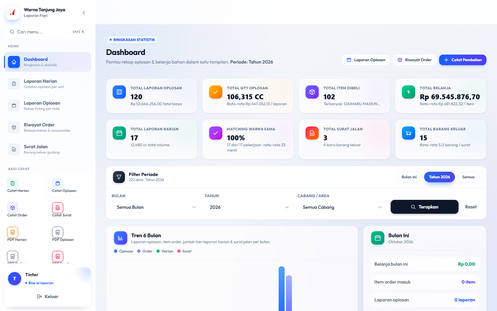

Bagian bawah dashboard memuat daftar **Laporan Harian Terbaru** dan **Surat Jalan Terbaru**,
masing-masing dengan penomoran halaman sendiri:

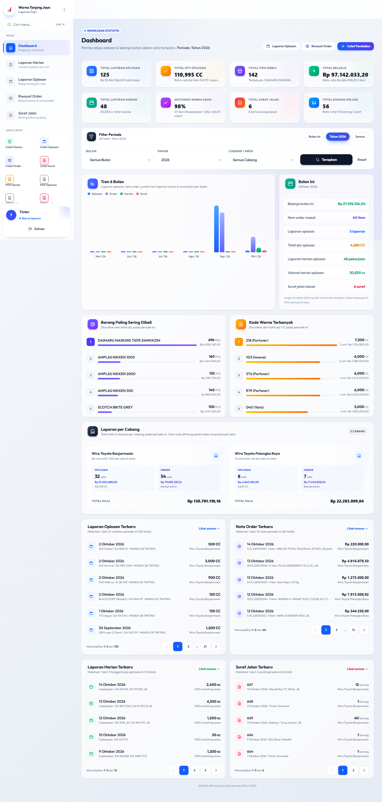

### Laporan Oplosan
Rekap tinting per unit, dipisah per cabang, dengan total nilai tiap nota.

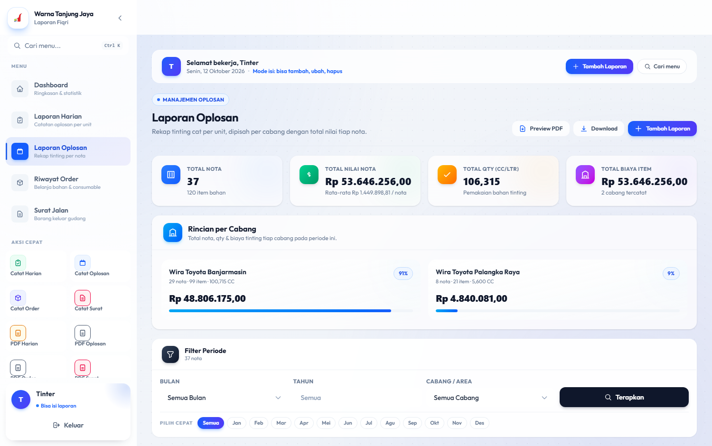

Yang dicatat di sini hanya pekerjaan **tinting** (ada kata `TINTING` pada rincian
bahannya). Belanja bahan pendukung — clear, hardener, spot putty, amplas, dan
sejenisnya — masuk ke **Riwayat Order**, bukan ke sini.

### Riwayat Order
Rekap belanja bahan & consumable per cabang.

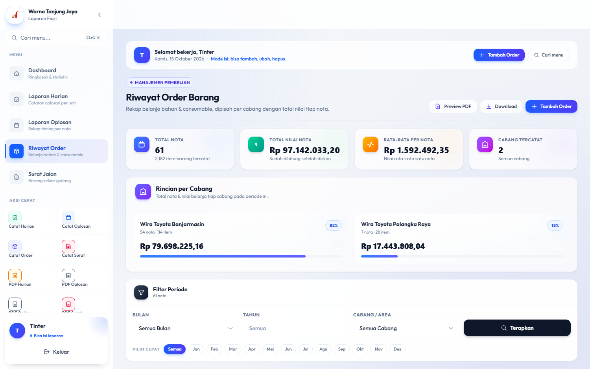

### Laporan Harian Oplosan
Catatan tiap pekerjaan oplosan: unit, bahan, volume, jam kerja, dan hasil matching warna.

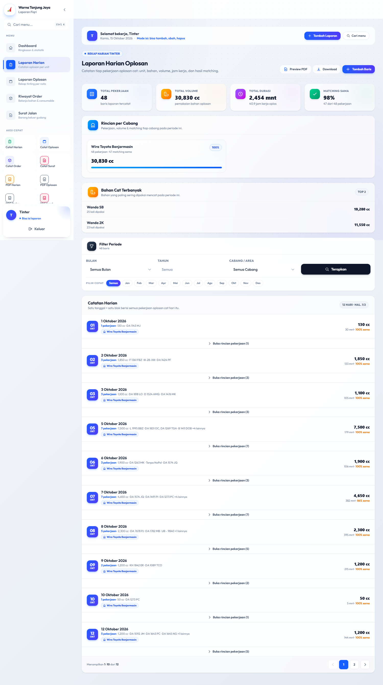

Daftarnya dipotong 10 tanggal per halaman supaya tidak memanjang, dan satu tanggal tampil sebagai
satu blok berisi semua pekerjaan hari itu:

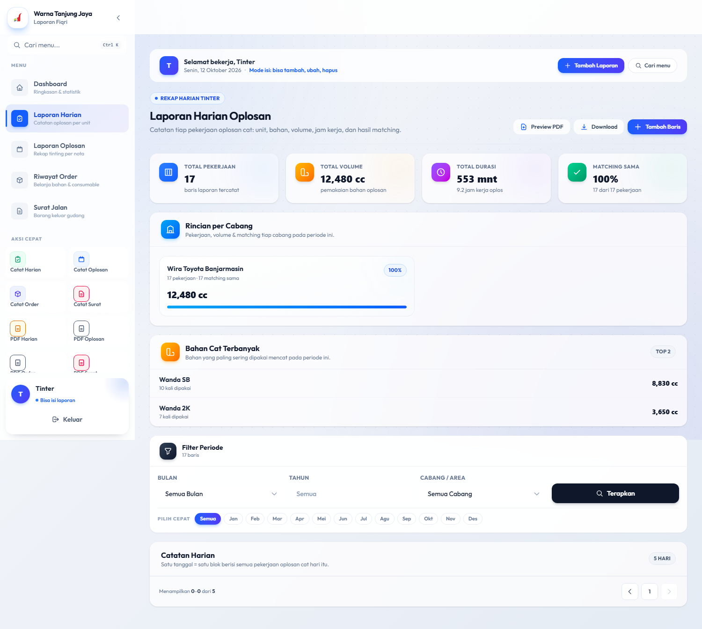

### Surat Jalan
Rekap barang keluar gudang. Halaman ini dibuka dengan ringkasan cepat di bagian atas: jumlah surat,
jumlah barang, total unit terkirim, dan jumlah jenis barang. Di bawahnya ada daftar **Barang Paling
Sering Dikirim** yang menampilkan frekuensi pengiriman tiap barang pada periode berjalan, jadi barang
yang paling sering keluar gudang langsung kelihatan.

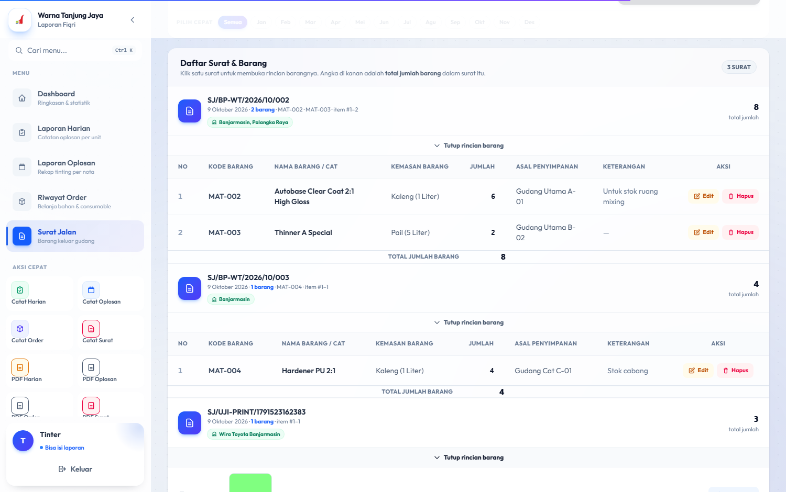

Daftar suratnya bisa difilter dan dicari, lalu satu nomor surat tampil sebagai satu kartu berisi
seluruh barangnya (kode barang, nama, kemasan, jumlah, asal penyimpanan, keterangan). Tiap surat bisa
dilampiri **foto print** sebagai bukti pengiriman. Thumbnail-nya muncul saat rincian barang dibuka,
bisa diklik untuk dilihat ukuran penuh, dan ikut tercetak di kop PDF surat jalan.

Rincian barang dibuka sebagai tabel yang bisa digeser ke samping, jadi kolom **Aksi** (edit/hapus)
tetap terjangkau walau layarnya sempit. Tabel rinciannya memuat Nomor Baris, Kode & Nama Barang,
Gudang, Kemasan, Qty Unit, Harga, Disc, dan Total. Setiap surat punya kolom **Status** dengan penanda
warna supaya tahap surat (mis. belum diverifikasi vs. sudah oke) langsung terbaca, dan tanggal
persetujuannya tercantum di kepala surat.

Form tambah & edit memakai susunan kartu yang sama — kepala surat (cabang, tanggal, no. surat),
barang yang dikirim, info barang lain di surat yang sama, lalu foto print:

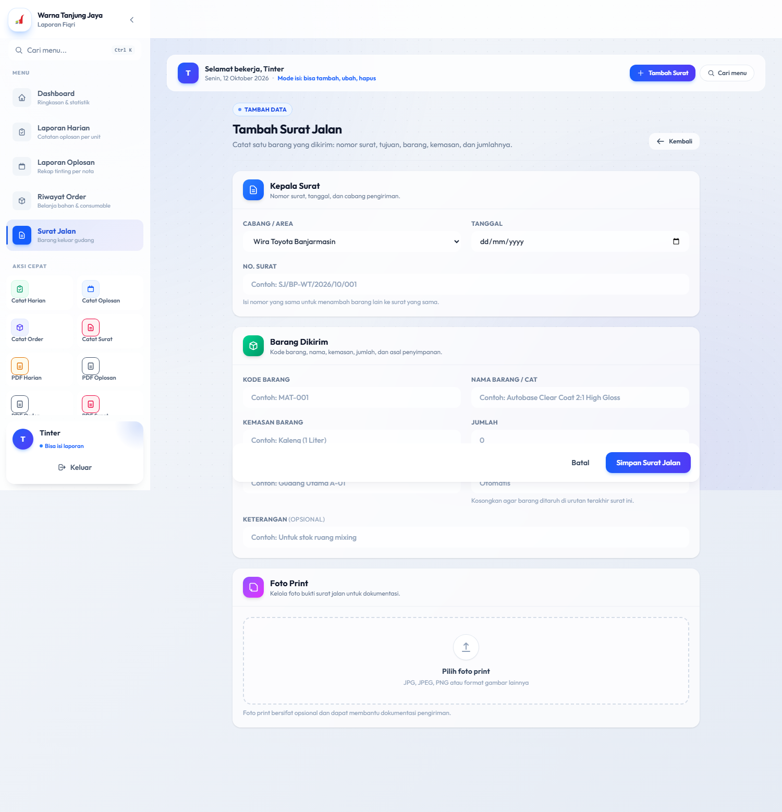

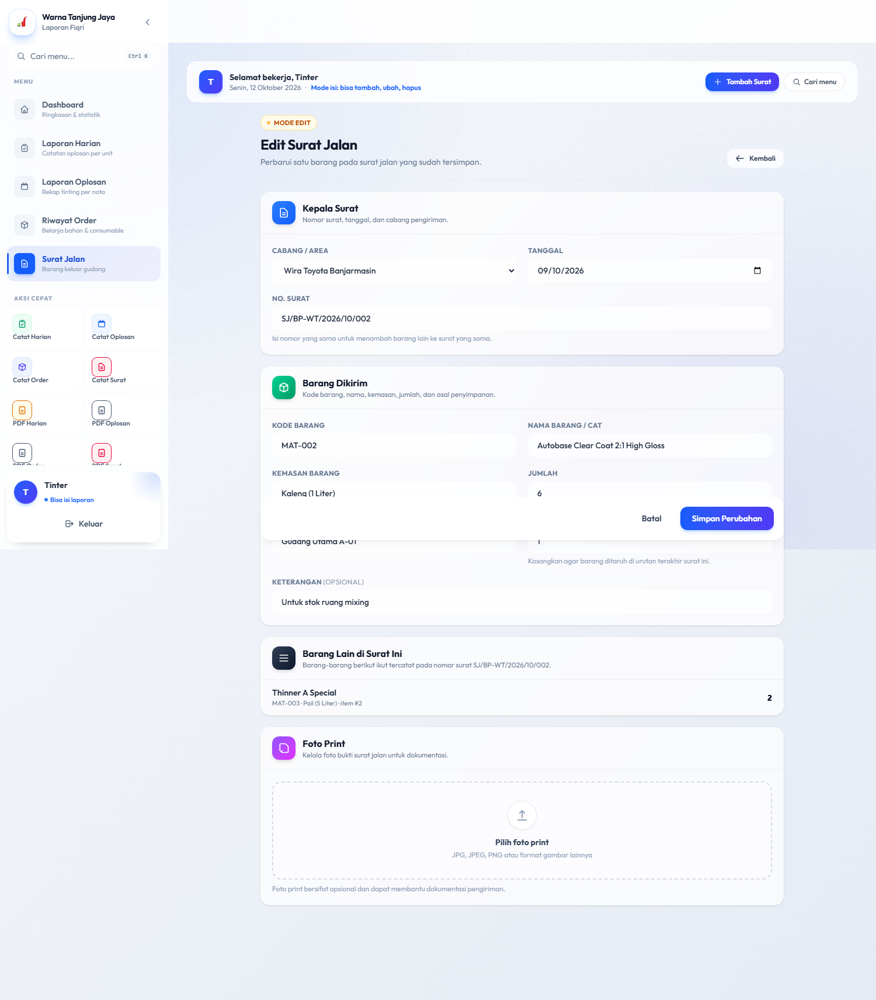

PDF-nya bisa dipratinjau dulu di browser sebelum dicetak atau diunduh:

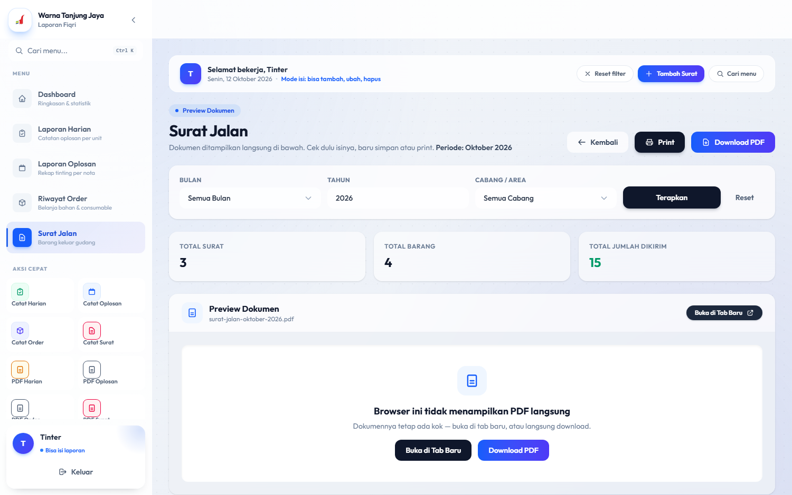

### Mode Manajer
Tampilan pengawasan — menyorot biaya yang menyimpang dari rata-rata dan mutu kerja oplosan.

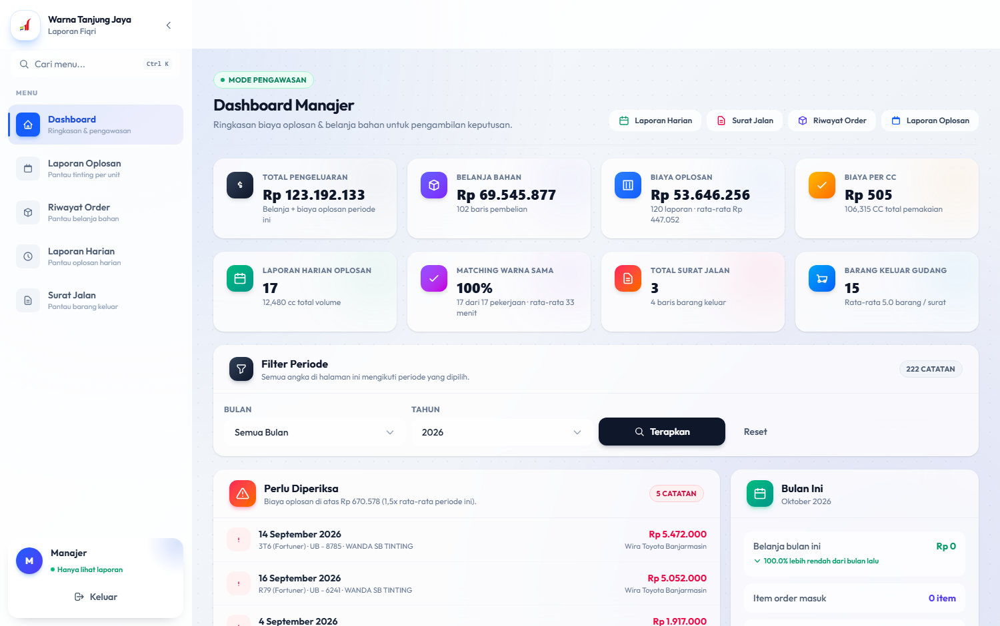

Kartu KPI-nya dibagi dua baris: biaya (pengeluaran, belanja bahan, biaya oplosan, biaya per CC)
lalu operasional (laporan harian, matching warna, surat jalan, barang keluar gudang).

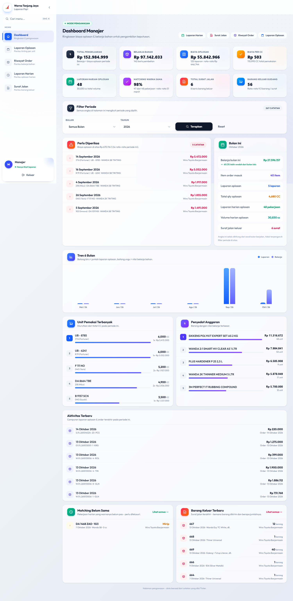

**Pantau Laporan Harian** — rekap mutu kerja: persentase matching warna, lama pengerjaan, unit tersibuk, dan catatan yang perlu ditelusuri.

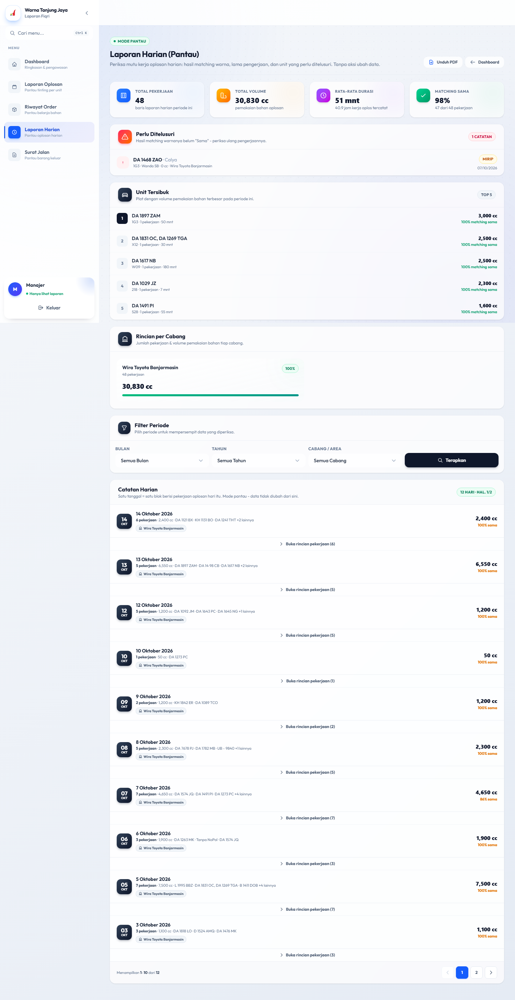

**Pantau Surat Jalan** — rekap barang keluar gudang: barang terbanyak keluar, tujuan pengiriman, dan rincian tiap surat.

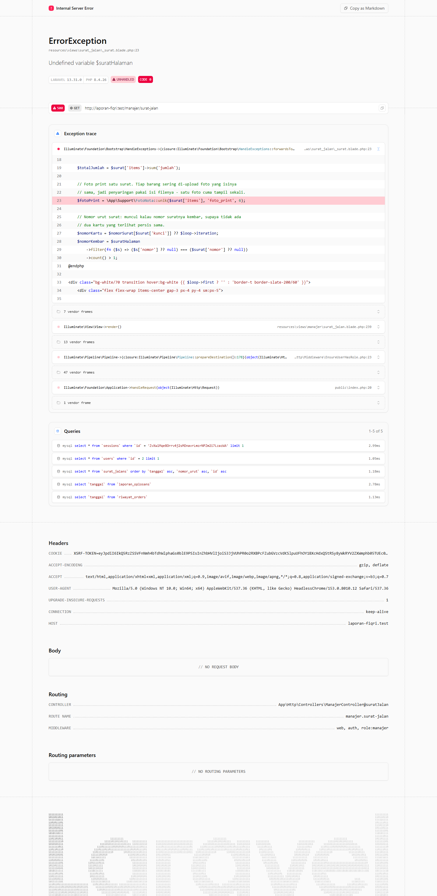

### Tampilan di HP
Bottom navigation, kartu bertumpuk, dan tombol besar supaya nyaman dipakai satu tangan.

<p align="center">
  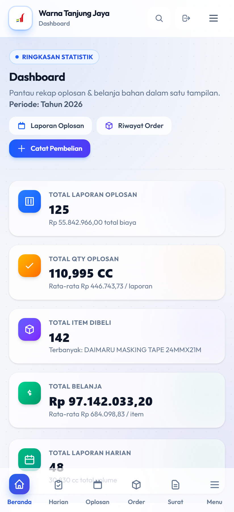
  &nbsp;&nbsp;
  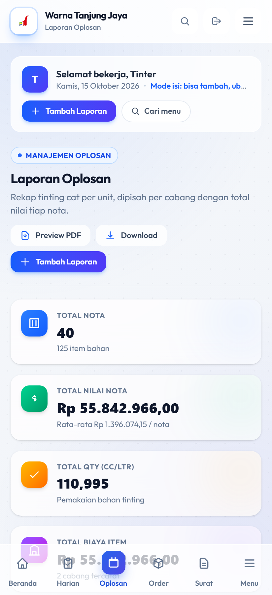
  &nbsp;&nbsp;
  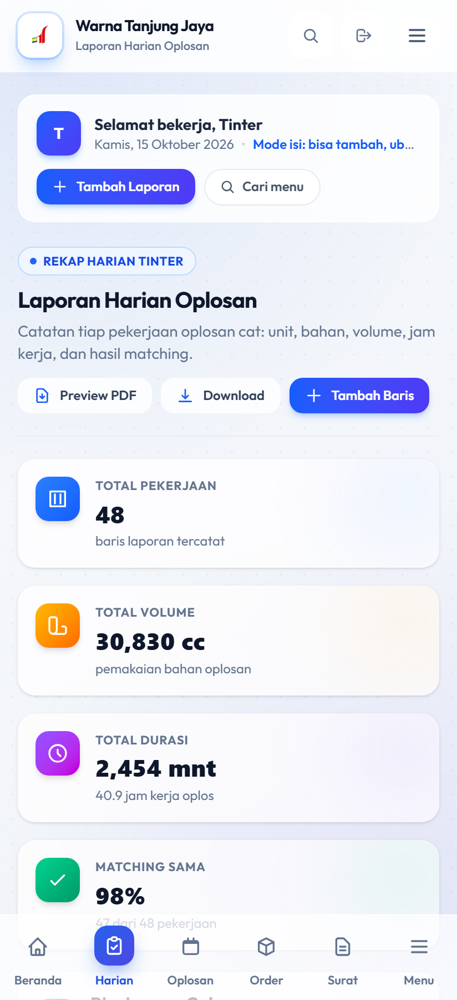
</p>

---

## Fitur

### Pencatatan
- **Laporan Harian Oplosan** — catat tiap pekerjaan oplosan harian: tanggal, no. plat, kode warna, tipe mobil, bahan cat, volume (cc), jam dibuat & jam selesai (durasi dihitung otomatis), hasil matching warna (Sama / Mirip / Beda), dan keterangan.
- **Laporan Oplosan** — catat pemakaian bahan tinting per unit kendaraan (no. plat, kode warna, rincian bahan, qty CC, harga nota).
- **Riwayat Order** — catat pembelian bahan & consumable (kode barang, qty, satuan, harga, diskon).
- **Surat Jalan** — catat barang keluar gudang (no. surat, tanggal, cabang, kode barang, nama barang/cat, kemasan, jumlah, asal penyimpanan, keterangan).
- Satu nota / surat bisa berisi **banyak item**. Item dengan nomor bukti (atau nomor surat) yang sama otomatis digabung jadi satu kartu.
- Upload foto nota/faktur, termasuk **foto print** untuk surat jalan sebagai bukti pengiriman.
- Nomor urut otomatis bila dikosongkan.
- **Ringkasan surat jalan** di atas daftar: jumlah surat, jumlah barang, total unit terkirim, jenis barang, plus daftar **barang paling sering dikirim**.
- **Status surat jalan** ditandai kolom berwarna dan tanggal persetujuan tercantum di kepala surat.

### Laporan & Statistik
- **Dashboard** — satu halaman memuat keempat modul: total laporan & biaya oplosan, total qty oplosan, item dibeli, total belanja, jumlah laporan harian & volume-nya, persentase matching warna, jumlah surat jalan & barang keluar. Dilengkapi tren 6 bulan (4 seri: oplosan, order, harian, surat), ringkasan bulan berjalan, barang paling sering dibeli, kode warna terbanyak, laporan per cabang, dan daftar aktivitas terbaru tiap modul.
- **Rekap Harian** — total pekerjaan, total volume, total/rata-rata durasi, persentase matching sama, rincian per cabang, dan bahan cat terbanyak dipakai.
- **Filter** berdasarkan bulan, tahun, dan cabang.
- **Rincian per cabang** — total nota, nilai, dan qty dipisah tiap cabang.
- **Total per nota** — dihitung dari seluruh item dalam satu nota (setelah diskon).
- **Export PDF** — preview di browser, cetak, atau unduh langsung.

### Daftar Panjang
Daftar yang isinya sudah menumpuk tidak dibentangkan semua — dipotong per halaman supaya halaman tetap pendek dan enak dilihat:

- **Laporan harian** — 10 tanggal per halaman (satu tanggal = satu blok, dipaginasi per hari).
- **Laporan oplosan, riwayat order, surat jalan** — 10 nota / surat per halaman.
- **Dashboard, aktivitas terbaru** — empat daftar (oplosan, order, laporan harian, surat jalan) masing-masing 5–6 baris per halaman, dengan **parameter halaman terpisah** (`hal_oplosan`, `hal_order`, `hal_harian`, `hal_surat`) supaya membuka halaman 2 satu daftar tidak menggeser daftar lainnya.
- Nota di dashboard dipotong **per nota**, bukan per baris item, jadi satu nota berisi 7 barang tetap utuh dalam satu halaman. Laporan harian dipotong **per tanggal**, surat jalan **per nomor surat**.

### Hak Akses

| Role | Bisa melakukan |
|---|---|
| **Tinter** | Melihat dashboard + **menambah / mengubah / menghapus** laporan (harian, oplosan, order, surat jalan) |
| **Manajer** | Hanya melihat — tampilan khusus pengawasan: dashboard biaya + mutu kerja, plus halaman pantau untuk laporan harian, oplosan, order, dan surat jalan |

### Tampilan
- Responsif penuh: **bottom navigation** di HP, sidebar di desktop.
- Command palette (Ctrl + K) untuk lompat antar halaman. Daftar menunya menyesuaikan role — manajer mendapat pintasan *Pantau Laporan Harian* & *Pantau Surat Jalan*.
- Tabel lebar bisa digeser ke samping tanpa merusak layout.
- Penomoran halaman seragam lewat komponen `x-pager` (elipsis otomatis kalau halamannya banyak).

> Screenshot di atas diambil otomatis lewat `scripts/ambil-screenshot.mjs`
> (Playwright). Jalankan `node scripts/ambil-screenshot.mjs` kalau tampilan berubah —
> pastikan aplikasi sudah jalan dulu (`APP_BASE_URL` default: `http://laporan-fiqri.test`).

---

## Kebutuhan Sistem

- **PHP** >= 8.3
- **Composer**
- **Node.js** >= 18 & npm
- **MySQL** (atau SQLite)

---

## Cara Menjalankan

```bash
# 1. Clone repository
git clone https://github.com/fiqrianwar1/Laporan-fiqri.git
cd Laporan-fiqri

# 2. Pasang dependency PHP & JS
composer install
npm install

# 3. Siapkan file konfigurasi
cp .env.example .env
php artisan key:generate
```

Lalu **atur koneksi database** di file `.env`:

```env
DB_CONNECTION=mysql
DB_HOST=127.0.0.1
DB_PORT=3306
DB_DATABASE=laporan_fiqri
DB_USERNAME=root
DB_PASSWORD=
```

```bash
# 4. Buat tabel & akun awal
php artisan migrate
php artisan db:seed

# 5. Build aset tampilan
npm run build

# 6. Jalankan
php artisan serve
```

Buka **http://localhost:8000**

> `php artisan db:seed` sekaligus mengimpor data contoh dari `sumber-data/teks/`
> (kalau folder itu ada). Data mentahnya sengaja tidak ikut ke repo karena besar.

### Data yang Sudah Masuk

| Modul | September 2026 | Oktober 2026 |
|---|---|---|
| Laporan oplosan (tinting) | 120 baris · 106.315 cc | 14 baris · 13.151 cc |
| Riwayat order (belanja bahan) | 102 baris | 22 baris |
| Laporan harian oplosan | — | 28 pekerjaan · 18.030 cc (7 hari) |
| Surat jalan | — | 1 surat |

Data September diimpor lewat `SumberDataSeeder` dan **angkanya dibandingkan dengan
yang tercetak di dokumen**: total oplosan 106.315 cc / Rp 53.646.256,00 dan grand
total order Rp 69.545.876,70 — keduanya pas, impor berhenti kalau meleset.

Data Oktober diisi dari faktur. Sebagian baris masih ditandai untuk ditelusuri
ulang lewat halaman **Edit** (mis. qty yang belum sesuai faktur), karena foto
fakturnya belum sempat dicocokkan satu per satu.

> Ada juga pintasan `composer setup` yang menjalankan langkah 2–5 sekaligus,
> dan `composer dev` untuk menjalankan server + queue + Vite bersamaan.

### Akun Bawaan

| Email | Password | Role |
|---|---|---|
| `tinter@warnatanjungjaya.com` | `password` | Tinter (bisa isi) |
| `manajer@warnatanjungjaya.com` | `password` | Manajer (hanya lihat) |

> **Penting:** ganti password ini sebelum dipakai sungguhan.

---

## Membuka dari HP (satu WiFi)

Tersedia skrip `buka-dari-hp.ps1` untuk Windows. Klik kanan file itu lalu pilih **Run with PowerShell**.

Skrip akan otomatis:

1. Mencari IP WiFi laptop
2. Menyetel `APP_URL` agar aset (CSS/JS) ikut termuat
3. Membuka port 8000 di firewall
4. Menjalankan server

Lalu buka link yang muncul di browser HP. **HP harus tersambung ke WiFi yang sama dengan laptop.**

Kalau HP tidak bisa membuka, jalankan skrip tersebut sebagai **Administrator**.

---

## Struktur Singkat

```
app/
  Http/Controllers/
    DashboardController.php        Ringkasan statistik (4 modul)
    LaporanHarianOplosanController.php  CRUD laporan harian + PDF
    LaporanOplosanController.php   CRUD oplosan + PDF
    RiwayatOrderController.php     CRUD order + PDF + paginasi bersama
    SuratJalanController.php       CRUD surat jalan + PDF
    ManajerController.php          Halaman pengawasan (4 halaman pantau)
  Models/
    LaporanHarianOplosan.php
    LaporanOplosan.php
    RiwayatOrder.php
    SuratJalan.php
  Support/
    Cabang.php                     Daftar cabang (satu sumber)
    NotaGrouper.php                Pengelompokan item jadi nota / surat
    HarianGrouper.php              Pengelompokan laporan harian per tanggal
    FotoNota.php                   Pengolahan & penyaringan foto nota (isi sama = 1 foto)
    SumberData.php                 Pembaca berkas mentah di sumber-data/teks
    Logo.php                       Path logo untuk kop PDF
    Rupiah.php                     Format angka rupiah
    Tanggal.php                    Format tanggal Indonesia

docs/screenshots/                  Screenshot untuk README
scripts/
  ambil-screenshot.mjs             Ambil screenshot otomatis (Playwright)
  render-contoh-pdf.php            Bikin contoh PDF dari data dummy (cek tampilan)

public/images/
  logo.jpg                        Logo untuk sidebar & kop PDF

resources/views/
  dashboard.blade.php              Dashboard tinter (4 modul)
  components/pager.blade.php       Penomoran halaman bersama
  laporan_harian/                  Halaman & PDF laporan harian
  laporan_oplosan/                 Halaman & PDF oplosan
  riwayat_order/                   Halaman & PDF order
  surat_jalan/                     Halaman & PDF surat jalan
  manajer/                         Halaman mode pantau
  layouts/app.blade.php            Layout utama (sidebar + bottom nav)
  layouts/manajer.blade.php        Menu khusus manajer

database/
  migrations/                      Skema tabel (termasuk kolom total_baris
                                   pada riwayat_orders & foto_print surat_jalan)
  seeders/DatabaseSeeder.php       Akun awal
  seeders/SumberDataSeeder.php     Impor data asli dari sumber-data/teks

sumber-data/teks/                  Teks hasil ekstraksi dokumen asli (oplosan,
                                   riwayat, harian) - dipakai SumberDataSeeder
```

### Menambah Cabang Baru

Edit `app/Support/Cabang.php`:

```php
public static function daftar(): array
{
    return [
        'Wira Toyota Banjarmasin',
        'Wira Toyota Palangka Raya',
        'Wira Toyota Cabang Baru',   // tambahkan di sini
    ];
}
```

Dropdown filter, form input, dan pengelompokan laporan otomatis ikut menyesuaikan.

---

## Catatan Teknis

- **Pengelompokan nota** — kunci pengelompokan adalah `nomor bukti + tanggal`, bukan id baris. Jadi satu nota berisi banyak item tetap dihitung **satu nota** di semua total.
- **Nilai total** — kalau kolom `total_baris` terisi, nilai itulah yang dipakai sebagai total kotor. Kalau kosong, baru dihitung `qty x harga satuan`. Alasannya: pada faktur Wira Toyota kolom qty berisi **volume cat (CC/LTR)**, bukan jumlah barang, sehingga `qty x harga satuan` tidak berlaku di sana — sedangkan faktur PT. Sumber Tanjung Jaya memang memakai qty sebagai jumlah barang. Kolom `total_baris` **nullable**, jadi faktur lama yang belum diisi tetap dihitung seperti semula.
- **Pemisahan oplosan vs belanja bahan** — satu nota Wira Toyota sering memuat keduanya sekaligus (pekerjaan tinting + bahan pendukung). Baris bertanda `TINTING` masuk `laporan_oplosans`, sisanya (clear, hardener, spot putty, dsb.) masuk `riwayat_orders`. Jadi satu nota bisa muncul di dua halaman sekaligus dengan isi yang berbeda — itu memang benar, bukan duplikat.
- **Filter cabang** — memakai kolom `cabang_area` di keempat tabel (`laporan_harian_oplosans`, `laporan_oplosans`, `riwayat_orders`, dan `surat_jalans`).
- **Laporan harian per tanggal** — dikelompokkan lewat `App\Support\HarianGrouper`, satu tanggal = satu blok. Tidak ada nomor nota, jadi kuncinya murni tanggal.
- **Surat jalan per nomor surat** — dikelompokkan lewat `App\Support\NotaGrouper` dengan kunci `nomor surat + tanggal`, jadi satu surat berisi banyak barang tetap dihitung satu surat.
- **Durasi otomatis** — kalau kolom durasi dikosongkan, `LaporanHarianOplosan::hitungDurasi()` menghitungnya dari jam dibuat & jam selesai (jam selesai lebih awal dianggap lewat tengah malam).
- **Paginasi dashboard** — dashboard punya empat daftar yang dipotong sendiri-sendiri. `RiwayatOrderController::paginateNotas()` menerima nama parameter halaman (`hal_harian`, `hal_surat`, dan `hal_order` untuk versi paginator nota), supaya membuka halaman 2 salah satu daftar tidak ikut menggeser daftar lainnya. Parameter itu juga disimpan balik ke query string paginator supaya tombol "Berikutnya" tetap membawa filter periode yang aktif.
- **Ringkasan dashboard** — kartu "Total Laporan Harian" dan "Matching Warna Sama" memakai periode filter; laporan harian dihitung per **baris pekerjaan**, sedangkan tren 6 bulan menghitungnya per **tanggal kerja** (satu hari = satu pekerjaan) supaya angkanya setara dengan daftar yang ditampilkan.
- **Logo** — `App\Support\Logo::path()` mengembalikan path file (bukan data-URI) karena DomPDF menolak data-URI base64. Lambangnya ditaruh di `public/images/logo.jpg` dan dipakai seragam oleh sidebar, halaman login, serta kop keempat PDF.
- **Foto bukti** — nota oplosan (`foto_nota`), riwayat order (`foto_faktur`), dan surat jalan (`foto_print`) disaring lewat `App\Support\FotoNota::unik()`: satu nota sering diisi beberapa item dengan foto yang isinya sama, jadi penyaringan dilakukan berdasarkan **isi file (md5)**, bukan nama path, supaya satu foto hanya tampil sekali. Di PDF, foto disematkan sebagai **base64** supaya DomPDF tidak perlu mengambil file lewat URL.
- **Form unggah** — form Tambah/Edit Surat Jalan memakai `enctype="multipart/form-data"`; tanpa itu file tidak ikut terkirim dan request jatuh ke halaman login. Foto lama tetap ditampilkan di form Edit dan hanya dihapus dari storage kalau benar-benar diganti.
- **Data sumber** — `SumberDataSeeder` membaca teks di `sumber-data/teks/` lalu **membandingkan hasil rekapnya dengan angka yang tercetak di dokumen asli**; kalau meleset, impor berhenti dengan error supaya data tidak masuk setengah jalan. Folder `sumber-data/` selain `teks/` (PDF & foto asli) tidak ikut ke repo - kalau teksnya tidak ada, impor dilewati tanpa menggagalkan `php artisan db:seed`.

---

## Lisensi

Proyek internal Warna Tanjung Jaya. Dibangun di atas [Laravel](https://laravel.com) (MIT License).
